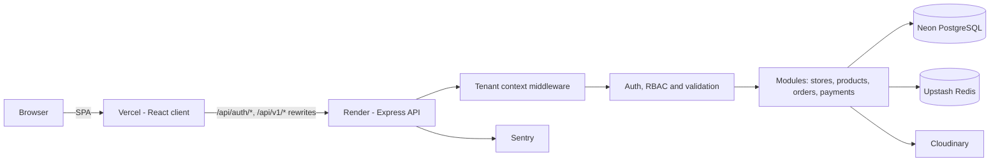

<div align="center">

<!-- TODO: replace with your logo (e.g. docs/screenshots/logo.png) -->


# Aura

**A multi-tenant e-commerce SaaS platform that lets merchants launch their own online store in minutes.**

Built with React 19, Express 5, Drizzle ORM, Neon PostgreSQL and Better Auth, designed first for the Ethiopian market.

[Live Demo](https://aura-marketplace-v1.vercel.app) · [API Plan](docs/API%20Endpoints.md) · [Routes Plan](docs/Client%20Routes%20and%20Pages.md) · [Blueprint](docs/Aura%20Master%20Development%20Blueprint.md)


<!-- TODO: add a hero screenshot or short GIF of the app -->


</div>

---

## Table of Contents

- [About](#about)
- [Screenshots](#screenshots)
- [Features](#features)
- [Tech Stack](#tech-stack)
- [Architecture](#architecture)
- [Project Structure](#project-structure)
- [Getting Started](#getting-started)
- [Environment Variables](#environment-variables)
- [Scripts](#scripts)
- [API Overview](#api-overview)
- [Frontend Routes](#frontend-routes)
- [Deployment](#deployment)
- [Roadmap](#roadmap)
- [Documentation](#documentation)
- [Author](#author)

---

## About

Aura is store infrastructure in the spirit of Shopify, rather than an open marketplace. Each merchant gets an isolated store with its own catalog, orders and staff, while the platform runs on a single shared backend and database.

Key ideas:

- **Multi-tenant by design.** Every tenant-scoped query is constrained by `storeId`, and requests are resolved to a store through a tenant-context middleware (subdomain or custom domain).
- **One global identity.** A single user account can be a customer, a store owner and store staff at the same time.
- **Commission-only business model.** No upfront fees. Aura takes a category-based commission on completed orders.
- **Server-side truth.** Prices, stock, delivery fees and commissions are always calculated on the backend, never trusted from the client.
- **Built for Ethiopia.** ETB currency, regional delivery zones, and local payment providers (Chapa, Telebirr) on the roadmap.

---

## Screenshots

> Replace the placeholders below with real screenshots. Put the files in `docs/screenshots/`.

| Home | Store page |
| :---: | :---: |
|  |  |

| Product details | Cart & checkout |
| :---: | :---: |
|  |  |

| Sign in / Sign up | Vendor onboarding |
| :---: | :---: |
|  |  |

| Store dashboard | Product creation wizard |
| :---: | :---: |
|  |  |

| Admin panel | Dark mode |
| :---: | :---: |
|  |  |

---

## Features

Items are marked by status: ✅ implemented · 🚧 in progress or partial · 🗓️ planned.

### Authentication and accounts
- ✅ Email and password sign-up and sign-in with Better Auth
- ✅ Google OAuth sign-in
- ✅ Email OTP verification and password reset
- ✅ HTTP-only, secure session cookies
- ✅ Role-aware protected routes (customer, vendor, admin)
- 🗓️ Ethiopian phone number and SMS OTP

### Stores and multi-tenancy
- ✅ Vendor registration and store creation
- ✅ Public store directory and store home pages (`/stores/:slug`)
- ✅ Tenant resolution middleware (subdomain based)
- ✅ Store memberships and permission-based authorization
- 🗓️ Multi-store switcher, custom domains with automated SSL

### Catalog
- ✅ Products with variants (options, SKU, price, stock)
- ✅ Multi-step product creation wizard (info, media, variants, inventory, review)
- ✅ Image uploads through Cloudinary
- 🚧 Product browsing, search, filtering and sorting
- 🗓️ Global and store-level categories with commission rates

### Cart, checkout and orders
- ✅ Persisted client-side cart (Zustand)
- ✅ Checkout with shipping information form
- ✅ Order creation with server-side validation and order numbers
- 🚧 Customer order history and store order management
- 🗓️ Order lifecycle state machine and atomic stock reservation

### Payments
- 🚧 Payment and subscription plan modules (Stripe configuration present)
- 🗓️ Chapa and Telebirr adapters, double-entry financial ledger, seller payouts

### Dashboards
- ✅ Store dashboard widgets: stats, sales overview, recent orders, low stock
- ✅ Admin area: dashboard, stores, payments and plan management
- ✅ Light and dark theme

### Platform and security
- ✅ Helmet, CORS, rate limiting (Upstash and express-rate-limit)
- ✅ Zod validation on requests and environment variables
- ✅ Centralized error handling and structured logging (Winston)
- ✅ Sentry error tracking
- 🗓️ Background jobs (BullMQ), reviews and wishlist, regional delivery zones

---

## Tech Stack

### Frontend (`client/`)

| Area | Technology |
| --- | --- |
| Framework | React 19, TypeScript, Vite 7 |
| Routing | React Router 7 |
| Styling and UI | Tailwind CSS v4, shadcn/ui, Base UI, Lucide icons, Framer Motion |
| Server state | TanStack Query |
| Client state | Zustand |
| Forms | React Hook Form, Zod |
| Auth | Better Auth client |
| Charts | Recharts |
| Feedback | Sonner, React Hot Toast |

### Backend (`server/`)

| Area | Technology |
| --- | --- |
| Runtime and framework | Node.js, Express 5, TypeScript |
| Database | Neon serverless PostgreSQL |
| ORM and migrations | Drizzle ORM and Drizzle Kit |
| Authentication | Better Auth (email, Google OAuth, email OTP) |
| Cache and rate limiting | Upstash Redis, `@upstash/ratelimit`, `express-rate-limit` |
| Media | Cloudinary and Multer |
| Email | Nodemailer (SMTP) |
| Validation | Zod |
| Security | Helmet, CORS, cookie-parser |
| Observability | Winston, Sentry |

### Hosting

Vercel (client), Render (API), Neon (database), Upstash (Redis), Cloudinary (media).

---

## Architecture



The Vercel deployment proxies `/api/auth/*` and `/api/v1/*` to the Render API through rewrites in [client/vercel.json](client/vercel.json). Session cookies therefore stay first-party on the Vercel domain.

The server is a modular monolith. Each domain module follows the same layering:

```
routes -> controller -> service -> repository -> Drizzle / Neon
              ^             ^
         validation      business rules
```

---

## Project Structure

```
Aura/
├── client/                     # React SPA
│   ├── src/
│   │   ├── app/                # main.tsx, providers, router
│   │   ├── components/         # ui (shadcn), layout, common, forms
│   │   ├── contexts/           # Theme context
│   │   ├── dashboard/          # customer home and store dashboard widgets
│   │   ├── features/           # auth, products, stores, cart, checkout,
│   │   │                       # orders, customer, payments, admin
│   │   ├── layouts/            # AppLayout, StoreLayout, AdminLayout
│   │   ├── lib/                # authClient, axios instance
│   │   └── pages/              # About, Contact, Pricing, Services, Error
│   └── vercel.json             # API rewrites and SPA fallback
│
├── server/
│   └── src/
│       ├── config/             # env, auth, redis, stripe, cloudinary, email
│       ├── db/                 # Drizzle client and schema
│       ├── middleware/         # authenticate, authorize, resolveTenant, upload...
│       ├── modules/            # auth, stores, products, variants, orders,
│       │                       # payments, memberships
│       ├── routes/             # API router
│       ├── templates/          # transactional email templates
│       ├── utils/              # ApiError, ApiResponse, hash, otp, logger...
│       └── server.ts
│
├── docs/                       # Product and technical documentation
└── README.md
```

---

## Getting Started

### Prerequisites

- Node.js 20 or newer and npm
- A [Neon](https://neon.tech) PostgreSQL database
- (Optional) an [Upstash](https://upstash.com) Redis database, a Cloudinary account and a Google OAuth client
- A [Sentry](https://sentry.io) DSN. The server's environment schema currently requires one.

### 1. Clone

```bash
git clone git@github.com:matusalasana/Aura.git
cd Aura
```

### 2. Backend

```bash
cd server
npm install
cp .env.example .env     # then fill in the values (see below)
npm run push             # push the Drizzle schema to your database
npm run dev              # http://localhost:3000
```

### 3. Frontend

```bash
cd client
npm install
npm run dev              # http://localhost:5173
```

In development the client talks to the API at `http://localhost:3000`. Better Auth is served from `/api/auth` and the REST API from `/api/v1`.

### Google sign-in setup

In the Google Cloud Console, create an OAuth client (Web application) and register:

| Setting | Development | Production |
| --- | --- | --- |
| Authorized JavaScript origin | `http://localhost:5173` | `https://<your-vercel-domain>` |
| Authorized redirect URI | `http://localhost:3000/api/auth/callback/google` | `https://<your-vercel-domain>/api/auth/callback/google` |

In production, `CLIENT_ORIGIN` on the API must exactly match the Vercel origin, with no trailing slash.

---

## Environment Variables

### Server (`server/.env`)

| Variable | Required | Description |
| --- | :---: | --- |
| `NODE_ENV` | no | `development`, `production` or `test` |
| `PORT` | no | API port (default `3000`) |
| `DATABASE_URL` | yes | Neon PostgreSQL connection string |
| `BETTER_AUTH_SECRET` | yes | Secret used to sign sessions |
| `BETTER_AUTH_URL` | yes | Public base URL of the auth service |
| `GOOGLE_CLIENT_ID` / `GOOGLE_CLIENT_SECRET` | for Google sign-in | OAuth credentials |
| `SENTRY_DSN` | yes | Sentry project DSN |
| `CLIENT_ORIGIN` | in production | Frontend origin, e.g. `https://aura.example.com` |
| `SERVER_ORIGIN` | in production | API origin |
| `TEST_HOSTNAME` | yes | Hostname used for local tenant/subdomain routing tests |
| `UPSTASH_REDIS_REST_URL` / `UPSTASH_REDIS_REST_TOKEN` | no | Redis for caching and rate limiting |
| `CLOUDINARY_CLOUD_NAME` / `_API_KEY` / `_API_SECRET` | for uploads | Media storage |
| `SMTP_HOST` / `SMTP_PORT` / `SMTP_USER` / `SMTP_PASS` / `SMTP_FROM` | for email | Production SMTP |
| `LOCAL_SMTP_HOST` / `LOCAL_SMTP_PORT` / `LOCAL_EMAIL_SENDER` | no | Local SMTP sink (e.g. Mailtrap) |

### Client (`client/.env`)

| Variable | Description |
| --- | --- |
| `VITE_API_URL` | Base URL of the REST API (`.../api/v1`) |
| `VITE_AUTH_API_URL` | Base URL of the API host |
| `VITE_CALLBACK_URL` | Absolute URL users return to after social sign-in |

> Never commit real secrets. `client/.env` and `server/.env` should be listed in `.gitignore`.

---

## Scripts

### Server

| Command | Description |
| --- | --- |
| `npm run dev` | Start the API with hot reload (`tsx watch`) |
| `npm run build` | Compile TypeScript and resolve path aliases |
| `npm start` | Run the compiled server from `dist/` |
| `npm run check` | Type-check without emitting |
| `npm run generate` | Generate Drizzle SQL migrations |
| `npm run migrate` | Apply migrations |
| `npm run push` | Push the schema directly to the database |
| `npm run seed` | Seed the database with sample data |
| `npm run schema:drop` | Reset the schema (destructive) |

### Client

| Command | Description |
| --- | --- |
| `npm run dev` | Start the Vite dev server |
| `npm run build` | Type-check and build for production |
| `npm run preview` | Preview the production build |
| `npm run check` | Type-check without emitting |
| `npm run lint` | Run ESLint |

---

## API Overview

REST base URL: `/api/v1`. Authentication is handled by Better Auth under `/api/auth/*`.

| Module | Mount point | Purpose |
| --- | --- | --- |
| Auth | `/auth` | Account and session helpers (OTP, password flows, current user) |
| Stores | `/stores` | Store creation, public lookup, management |
| Products | `/products` | Catalog browsing and product management |
| Orders | `/orders` | Order creation and order history |
| Payments | `/payments` | Plans and payment processing |

The full target endpoint plan (checkout, dashboard summaries, admin moderation, uploads and more) is in [docs/API Endpoints.md](docs/API%20Endpoints.md). Not every planned endpoint exists yet.

---

## Frontend Routes

| Area | Routes |
| --- | --- |
| Public | `/`, `/sign-in`, `/sign-up`, `/about`, `/contact`, `/pricing`, `/services`, `/stores`, `/stores/:slug`, `/stores/:slug/products`, `/stores/:slug/products/:productId` |
| Customer (auth) | `/cart`, `/checkout`, `/orders`, `/account` |
| Store management (auth) | `/stores/me`, `/stores/products` |
| Admin (auth) | `/admin`, `/admin/stores`, `/admin/payments` |

The target route map, including `/shop/:slug`, `/stores/:storeId/*` and `/admin/users`, is described in [docs/Client Routes and Pages.md](docs/Client%20Routes%20and%20Pages.md).

---

## Deployment

| Layer | Provider | Notes |
| --- | --- | --- |
| Client | Vercel | Build `npm run build`, output `dist`. Rewrites in `vercel.json` proxy the API. |
| API | Render | Build `npm install && npm run build`, start `npm start`. Set `NODE_ENV=production`. |
| Database | Neon | Run `npm run migrate` (or `push`) against production. |
| Redis | Upstash | Optional, used for caching and rate limiting. |
| Media | Cloudinary | Configure the credentials listed above. |

Checklist before going live:

- [ ] `NODE_ENV=production` and `CLIENT_ORIGIN` set on the API
- [ ] Google OAuth origins and redirect URIs match the production domain
- [ ] Database migrations applied
- [ ] Sentry DSN configured on the API
- [ ] Secrets rotated and absent from git history

---

## Roadmap

Condensed from the 18-phase plan in the [Master Blueprint](docs/Aura%20Master%20Development%20Blueprint.md).

- [x] **Foundation:** repo structure, Neon, Drizzle, Express skeleton
- [x] **Identity:** Better Auth, Google OAuth, email OTP
- [x] **Multi-tenancy and stores:** tenant middleware, store creation
- [x] **Staff and RBAC:** memberships and permission checks
- [ ] **Catalog:** variants (done), categories and commissions, search and filtering
- [ ] **Media pipeline:** signed direct uploads to Cloudinary
- [ ] **Cart and inventory:** server-synced carts, atomic stock reservation
- [ ] **Payments:** Chapa and Telebirr, webhook verification
- [ ] **Ledger and commissions:** double-entry ledger and payouts
- [ ] **Orders:** full lifecycle state machine and fulfillment UI
- [ ] **Delivery:** Ethiopian region and zone pricing
- [ ] **Customer experience:** wishlist and verified reviews
- [ ] **Background jobs:** BullMQ workers, email and SMS notifications
- [ ] **Entitlements:** plan-based feature gating
- [ ] **Storefront builder:** visual section editor and custom pages
- [ ] **Moderation and admin:** product moderation, dispute escalation
- [ ] **Custom domains and launch:** CNAME verification, Cloudflare SSL, security hardening

---

## Documentation

| Document | Contents |
| --- | --- |
| [Master Development Blueprint](docs/Aura%20Master%20Development%20Blueprint.md) | Product vision, business model, multi-tenancy, database design, security and roadmap |
| [API Endpoints](docs/API%20Endpoints.md) | Planned MVP REST endpoints |
| [Client Routes and Pages](docs/Client%20Routes%20and%20Pages.md) | Frontend route map and build order |

---

## Author

**Sana**, Full Stack Developer

Repository: [github.com/matusalasana/Aura](https://github.com/matusalasana/Aura)

<!-- TODO: add LinkedIn / portfolio / email links -->

---

<div align="center">

If you find Aura interesting, consider giving it a star.

</div>
